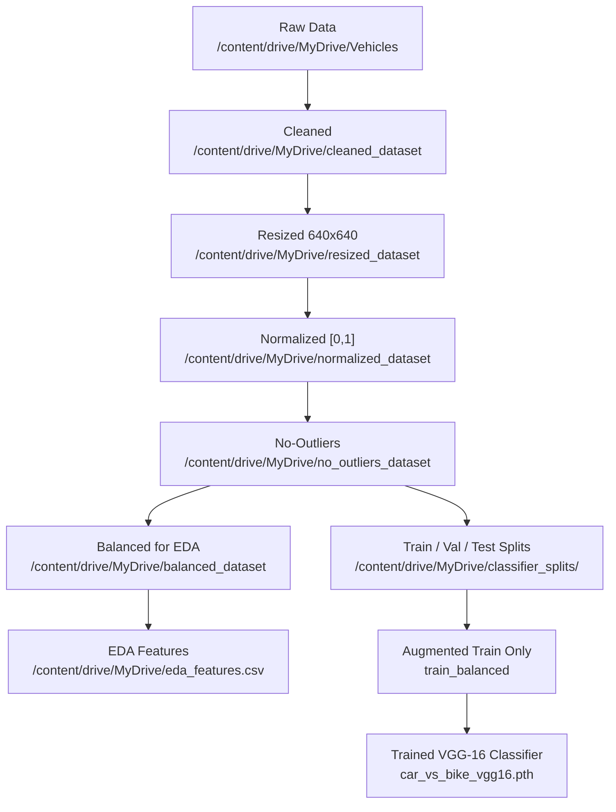

# Smart Vehicle Detection & Parking Slot Allocation System

## Overview
Searching for vacant parking spots in congested lots wastes time, increases fuel consumption, and raises emissions. This project provides an AI/ML-driven solution: detecting vehicles (Cars vs. Motorcycles) from camera feeds and allocating suitable parking slots based on vehicle type and availability.

The repository implements a complete end-to-end image processing and deep learning pipeline:

| Step | Description |
|------|-------------|
| 1. **Cleaning** | Removes corrupted/unreadable files and filters blurry images (Laplacian variance < 500) |
| 2. **Resizing** | Standardizes all images to 640×640 px |
| 3. **Normalization** | Scales pixel values to [0, 1] range, saves as PNG |
| 4. **Outlier Removal** | Extracts VGG-16 features and removes noisy/mislabeled samples via Isolation Forest |
| 5. **Class Distribution** | Generates class statistics and exports to Excel |
| 6. **Dataset Balancing** | Augments minority class for balanced EDA exploration |
| 7. **Feature Extraction** | PCA-reduced VGG-16 features saved for EDA visualization |
| 8. **Classification** | Splits data → balances train only → fine-tunes VGG-16 → evaluates on held-out test set |

---

## Problem Statement

**Problem**: Drivers waste time searching for parking in dense lots, causing congestion and unnecessary emissions.

**Solution**:
- Classify incoming vehicles (Car vs. Motorcycle) automatically via camera feed.
- Route each vehicle to a dedicated slot matching its type.
- Track slot occupancy in real time to optimize space utilization and flow.

---

## Dataset

- **Classes**: `Cars`, `Motorcycles`
- **Source**: [Raw Dataset (SharePoint)](data/raw/raw%20data%20file%20link.txt)
- **Supported formats**: `.jpg`, `.jpeg`, `.png`, `.bmp`, `.webp`, `.gif`, `.tif`, `.tiff`
- **Initial size**: ~1,600+ labeled images
- **Issues addressed**: corrupted files, blurry images, mislabeled outliers, class imbalance

---

## Repository Structure

```
VehicleClassifier/
├── VehicleClassifierPipeline.ipynb           # Master end-to-end Colab pipeline (Steps 1–8)
├── notebooks/                                # Individual step-by-step exploration notebooks
│   ├── Remove_corrupted&blurry_images.ipynb  # Step 1: Remove corrupted & blurry images
│   ├── Resizing&Rescaling .ipynb             # Step 2: Resize images to 640×640
│   ├── Normalization.ipynb                   # Step 3: Normalize pixel values to [0, 1]
│   ├── RemoveOutliers.ipynb                  # Step 4: Isolation Forest outlier removal
│   ├── VisualizeClassDistribution.ipynb      # Step 5: Class distribution analysis
│   └── BalanceDataset.ipynb                  # Step 6 & 7: Augmentation & PCA visualization
├── data/
│   └── raw/
│       └── raw data file link.txt            # Link to download the original dataset
├── results/
│   ├── eda_visualizations/                   # EDA plots, distribution charts, PCA figures
│   └── result/
│       └── Final processed dataset.txt       # Link to download the final processed dataset
├── LICENSE
└── README.md
```

---

## Pipeline Flow (Google Drive)



---

## Outputs (Google Drive)

| Output | Path |
|--------|------|
| Cleaned images | `/content/drive/MyDrive/cleaned_dataset` |
| Resized images (640×640) | `/content/drive/MyDrive/resized_dataset` |
| Normalized images ([0,1]) | `/content/drive/MyDrive/normalized_dataset` |
| Outliers removed | `/content/drive/MyDrive/no_outliers_dataset` |
| Balanced dataset (EDA) | `/content/drive/MyDrive/balanced_dataset` |
| Classifier splits | `/content/drive/MyDrive/classifier_splits/` (`train`, `val`, `test`, `train_balanced`) |
| Trained model weights | `/content/drive/MyDrive/car_vs_bike_vgg16.pth` |
| Class distribution | `/content/class_distribution.xlsx` |
| EDA features (PCA) | `/content/drive/MyDrive/eda_features.csv` |

---

## Notes

- **GPU recommended**: Use a Colab GPU runtime for significantly faster VGG-16 feature extraction and model training.
- **Storage**: Ensure sufficient Google Drive space — intermediate datasets can be large.
- **Data leakage prevention**: The dataset is split into train/val/test *before* any augmentation. Only the training split is balanced, ensuring the val and test sets contain only original, unseen images.
- **Key parameters**: `blur_threshold = 500.0` (blurriness filter) · `contamination = 0.05` (Isolation Forest outlier ratio)